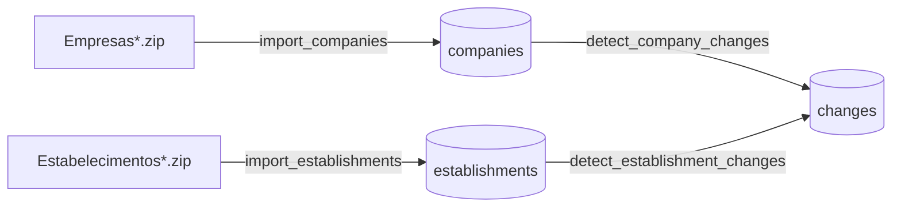

# Ingestor

Loads Receita Federal's monthly open CNPJ data into ClickHouse and detects what changed for each
company from one month to the next. Part of [Lince](../../README.md).

## How it works



1. **Import** (`Ingestor.import_companies/1`, `Ingestor.import_establishments/1`): takes a month
   directory, unzips each zip of the dataset in turn, stream-parses the ISO-8859-1 CSV into UTF-8
   and inserts it into the staging table (e.g. `companies_staging`) in batches of 10,000 rows.
   When every file is loaded, the month is swapped into the final table at once. Files of several
   GB are processed with constant memory.
2. **Detect changes** (`Ingestor.detect_company_changes/1`,
   `Ingestor.detect_establishment_changes/1`): compares a month with the month
   before and stores one row per change in `changes`, tagged with the dataset. Both months must
   be imported.

Datasets (file prefix, parser, table, key and compared fields) are configured in
`Ingestor.Datasets`; adding one is a configuration entry, not a new pipeline.

Both operations are idempotent: running them again for the same month replaces the result.

## Usage

Imports and change detection are run from `iex -S mix` (the HTTP API below only reads):

```elixir
Ingestor.import_companies(%{
  data_dir: Path.expand("~/lince-data/2026-09"),
  reference_month: ~D[2026-09-01]
})
#=> {:ok, %Ingestor.Pipeline.ImportMonth.Output{inserted: ...}}

Ingestor.import_establishments(%{
  data_dir: Path.expand("~/lince-data/2026-09"),
  reference_month: ~D[2026-09-01]
})
#=> {:ok, %Ingestor.Pipeline.ImportMonth.Output{inserted: ...}}

Ingestor.detect_company_changes(%{reference_month: ~D[2026-09-01]})
#=> {:ok, %Ingestor.Pipeline.DetectChanges.Output{changes: ...}}

Ingestor.detect_establishment_changes(%{reference_month: ~D[2026-09-01]})
#=> {:ok, %Ingestor.Pipeline.DetectChanges.Output{changes: ...}}

# 8 characters: the company and all its establishments.
# 14 characters: one establishment plus its company-level changes.
# Punctuation is ignored and letters are accepted (alphanumeric CNPJ, July 2026).
Ingestor.list_changes(%{cnpj: "00.000.000/0001-91", since: ~D[2026-01-01]})
#=> {:ok, %Ingestor.Pipeline.ListChanges.Output{changes: [%Ingestor.Schemas.Change{}, ...]}}
```

Errors come back as `{:error, type, detail}`:

| Type | When |
|---|---|
| `:invalid_input` | `detail` is the changeset (e.g. directory not found, month not on day 1) |
| `:no_files` | `detail` is the directory, which has no zip of the dataset |
| `:extract_failed` | `detail` is `{zip_path, reason}` for the zip that could not be extracted |
| `:load_failed` | a CSV line could not be parsed or inserted |
| `:publish_failed` | the staged month could not be swapped into the final table |
| `:month_not_imported` | `detail` is the month (current or previous) missing from the dataset |
| `:detect_failed` | the change detection query failed |
| `:fetch_failed` | the query listing a CNPJ's changes failed |

## HTTP API

JSON over HTTP on port 4002 (`http://ingestor:4002` inside Docker Compose).

### `GET /health`

Liveness check. Always `200 {"status": "ok"}` while the service is up.

### `GET /changes`

The changes detected for a CNPJ, newest month first.

| Query param | Required | Description |
|---|---|---|
| `cnpj` | yes | 8-character root (the company and all its establishments) or 14-character full CNPJ (one establishment plus its company-level changes). Punctuation is ignored; letters are accepted in the first 12 characters (alphanumeric CNPJ). |
| `since` | no | `YYYY-MM-DD`; only changes from that reference month on. |

```bash
curl -s 'localhost:4002/changes?cnpj=00.000.000/0001-91&since=2026-09-01'
```

```json
{
  "data": [
    {
      "dataset": "establishments",
      "reference_month": "2026-09-01",
      "cnpj_root": "00000000",
      "cnpj_order": "0001",
      "cnpj_check_digits": "91",
      "change_type": "updated",
      "field": "registration_status_code",
      "previous_value": "02",
      "current_value": "08",
      "detected_at": "2026-10-03T12:00:00.000Z"
    }
  ]
}
```

`cnpj_order` and `cnpj_check_digits` are `null` for company-level changes; `field` is `null` for
`created` / `removed`.

| Status | When | Body |
|---|---|---|
| 200 | always, even with no changes | `{"data": [...]}` |
| 422 | invalid `cnpj` or `since` | `{"errors": {"cnpj": ["can't be blank"]}}` |
| 500 | internal failure (details are logged, not returned) | `{"errors": {"detail": "Internal Server Error"}}` |

## Data model

**`companies`**: one row per CNPJ root per reference month, as published by Receita Federal.

**`establishments`**: one row per full CNPJ (headquarters or branch) per reference month.

**`changes`**: one row per change found in a dataset in a reference month, identified by
`dataset` and the CNPJ (`cnpj_order` / `cnpj_check_digits` are empty for `companies`).

| change_type | Meaning | field / previous_value / current_value |
|---|---|---|
| `created` | the row appeared this month | empty |
| `removed` | the row disappeared this month | empty |
| `updated` | a field changed | field name, old and new value (as strings) |

All tables are ordered by `cnpj_root` first, so "history of one company" is a fast lookup.

## Design decisions

- **The diff runs inside ClickHouse.** Each month has ~60M companies; moving two months to Elixir
  to compare them would mean ~120M rows over HTTP. A single `INSERT ... SELECT` does it in place.
- **`GROUP BY` the dataset's key instead of `FULL OUTER JOIN`.** A join holds one whole month in memory
  as a hash table; an aggregation can spill to disk.
- **Tables are partitioned by month and a month is always replaced as a whole.** A re-run can
  produce *fewer* rows than before (a company missing from the new files, a change that no longer
  exists); a `ReplacingMergeTree` would only overwrite rows with the same key and keep the stale
  ones.
  - A dataset's month is loaded into its staging table (e.g. `companies_staging`) and swapped in
    with `REPLACE PARTITION`, which is atomic: readers never see a half-loaded month and a failed
    import keeps the old one.
  - `changes` is partitioned by `(reference_month, dataset)` and filled by a single
    `INSERT ... SELECT`, so it just drops that partition before inserting; re-detecting one
    dataset never touches another dataset's changes.
- **Railway-style pipelines** (`lib/ingestor/pipeline/`): each step returns `{:ok, params}` or
  `{:error, type, detail}` and the first error skips the remaining steps.

## Development

Requires the infrastructure from the repository root (`docker compose up -d`). Tests, format and
Credo run inside the `tests` container:

```bash
docker compose run --rm tests bash
mix test
mix format --check-formatted
mix credo --strict
```
