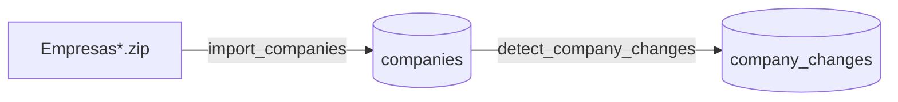

# Ingestor

Loads Receita Federal's monthly open CNPJ data into ClickHouse and detects what changed for each
company from one month to the next. Part of [Lince](../../README.md).

## How it works



1. **Import** (`Ingestor.import_companies/1`): takes a month directory, unzips each
   `Empresas*.zip` in turn, stream-parses the ISO-8859-1 CSV into UTF-8 and inserts it into
   `companies_staging` in batches of 10,000 rows. When every file is loaded, the month is swapped
   into `companies` at once. Files of several GB are processed with constant memory.
2. **Detect changes** (`Ingestor.detect_company_changes/1`): compares a month with the month
   before and stores one row per change in `company_changes`. Both months must be imported.

Both operations are idempotent: running them again for the same month replaces the result.

## Usage

There is no HTTP API yet; call the facade from `iex -S mix`:

```elixir
Ingestor.import_companies(%{
  data_dir: Path.expand("~/lince-data/2026-09"),
  reference_month: ~D[2026-09-01]
})
#=> {:ok, %Ingestor.Pipeline.ImportCompanies.Output{inserted: ...}}

Ingestor.detect_company_changes(%{reference_month: ~D[2026-09-01]})
#=> {:ok, %Ingestor.Pipeline.DetectCompanyChanges.Output{changes: ...}}
```

Errors come back as `{:error, type, detail}`:

| Type | When |
|---|---|
| `:invalid_input` | `detail` is the changeset (e.g. directory not found, month not on day 1) |
| `:no_files` | `detail` is the directory, which has no `Empresas*.zip` |
| `:extract_failed` | `detail` is `{zip_path, reason}` for the zip that could not be extracted |
| `:load_failed` | a CSV line could not be parsed or inserted |
| `:publish_failed` | the staged month could not be swapped into `companies` |
| `:month_not_imported` | `detail` is the month (current or previous) missing from `companies` |
| `:detect_failed` | the change detection query failed |

## Data model

**`companies`**: one row per CNPJ root per reference month, as published by Receita Federal.

**`company_changes`**: one row per change found in a reference month.

| change_type | Meaning | field / previous_value / current_value |
|---|---|---|
| `created` | CNPJ root appeared this month | empty |
| `removed` | CNPJ root disappeared this month | empty |
| `updated` | a field changed | field name, old and new value (as strings) |

Both tables are ordered by `cnpj_root`, so "history of one company" is a fast lookup.

## Design decisions

- **The diff runs inside ClickHouse.** Each month has ~60M companies; moving two months to Elixir
  to compare them would mean ~120M rows over HTTP. A single `INSERT ... SELECT` does it in place.
- **`GROUP BY cnpj_root` instead of `FULL OUTER JOIN`.** A join holds one whole month in memory
  as a hash table; an aggregation can spill to disk.
- **Tables are partitioned by month and a month is always replaced as a whole.** A re-run can
  produce *fewer* rows than before (a company missing from the new files, a change that no longer
  exists); a `ReplacingMergeTree` would only overwrite rows with the same key and keep the stale
  ones.
  - `companies` is loaded into `companies_staging` and swapped in with `REPLACE PARTITION`, which
    is atomic: readers never see a half-loaded month and a failed import keeps the old one.
  - `company_changes` is a single `INSERT ... SELECT`, so it just drops the month's partition
    before inserting.
- **Railway-style pipelines** (`lib/ingestor/pipeline/`): each step returns `{:ok, params}` or
  `{:error, type, detail}` and the first error skips the remaining steps.

## Development

Requires the infrastructure from the repository root (`docker compose up -d`). Tests, format and
Credo run inside the `tests` container:

```bash
docker compose run --rm tests bash
mix test
mix format --check-formatted
mix credo --strict
```
